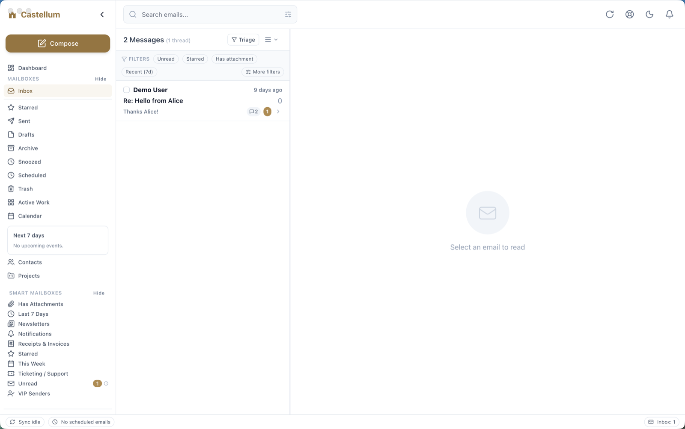

<!-- SPDX-License-Identifier: Apache-2.0 -->

# Castellum

A fast, keyboard-driven, local-AI-first email client for macOS (Apple Silicon).

The stack is a **Rust core** (IMAP and SMTP sync, SQLite storage, full-text search,
an operation queue) behind a small C ABI, with a **Swift/AppKit** macOS app on top.
AI features talk to a model you run yourself (for example Ollama on `localhost`);
nothing is sent to a hosted AI service by default.



The screenshot uses a throwaway demo account, not real mail.

## Status

Pre-1.0. The app builds and its test suites pass, but expect rough edges.
It is licensed under Apache-2.0 and has no licence keys, trial or paywall.

## Requirements

- macOS 14 or later on Apple Silicon
- Rust (`rustup`; the toolchain is pinned in `native/rust-toolchain.toml`)
- Xcode with command line tools (Swift 6.3 or later)
- `xcodegen` (`brew install xcodegen`)
- Optional: Docker, for the local GreenMail IMAP server used by the end-to-end tests

## Build and run

```bash
# 1. Rust core and the FFI static library
cd native && cargo build --release -p castellum-ffi && cd ..

# 2. Generate the Xcode project and build the app, unsigned
xcodegen generate --spec apple/project.yml
xcodebuild -project apple/Castellum.xcodeproj -scheme Castellum \
  -configuration Debug -destination 'platform=macOS' CODE_SIGNING_ALLOWED=NO build
```

Open the built `Castellum.app` from Xcode's DerivedData folder, or run the scheme from Xcode.

### Signing with your own identity

No Apple Team ID is committed. `DEVELOPMENT_TEAM` is empty in `apple/configs/*.xcconfig`;
pass your own on the command line (`DEVELOPMENT_TEAM=ABCDE12345`) or set it in Xcode.
The default bundle identifier is `uk.co.riera.castellum`; change `apple/project.yml`
if you build your own distribution. The Share Extension hand-off only works in a
build signed with a team, by design.

### Accounts

Castellum signs in with IMAP and SMTP using a password or an app password.

### OAuth: bring your own Google and Microsoft app

No OAuth client ID or secret ships in this repository or in the source build.
Providers that only allow OAuth2 sign-in (Gmail without an app password,
Outlook.com and Microsoft 365) need you to register your own application:

1. Google: in the [Google Cloud console](https://console.cloud.google.com/apis/credentials)
   create an OAuth client of type "Desktop app", enable the Gmail API scope you
   need, and note the client ID and secret.
2. Microsoft: in [Microsoft Entra](https://entra.microsoft.com) register an app
   ("Mobile and desktop applications", redirect URI `http://localhost`) with the
   delegated IMAP and SMTP scopes, and note the application (client) ID.
3. Copy `.env.example` to `.env` (git-ignored) and fill in your own values.
   Never commit `.env`, and never paste real credentials into issues.

The variable names are `GOOGLE_CLIENT_ID`, `GOOGLE_CLIENT_SECRET`,
`MICROSOFT_CLIENT_ID` and `MICROSOFT_CLIENT_SECRET`. The current macOS build does
not yet run an OAuth sign-in flow (OAuth-only providers are reported as not
supported); these are the settings a build that does will read.

## Tests

```bash
cargo test --manifest-path native/Cargo.toml          # Rust core
docker compose -f scripts/local-imap/docker-compose.yml up -d   # optional, for e2e
xcodebuild -project apple/Castellum.xcodeproj -scheme Castellum \
  -configuration Debug -destination 'platform=macOS' CODE_SIGNING_ALLOWED=NO test
```

## Layout

```
native/   Rust workspace: castellum-core, -db, -mail, -models, -providers,
          -provider-imap, -provider-smtp, -provider-ollama, -ffi (staticlib)
apple/    Swift/AppKit macOS app (XcodeGen project) that links the staticlib
docs/     user help pages and reference notes
scripts/  UI-scenario harness, GreenMail test server, CI helpers
brand/    logo files
```

## Contributing, security, conduct

- [CONTRIBUTING.md](CONTRIBUTING.md)
- [SECURITY.md](SECURITY.md) (report vulnerabilities privately)
- [CODE_OF_CONDUCT.md](CODE_OF_CONDUCT.md)

## Licence

Apache License 2.0. See [LICENSE](LICENSE) and [NOTICE](NOTICE).
